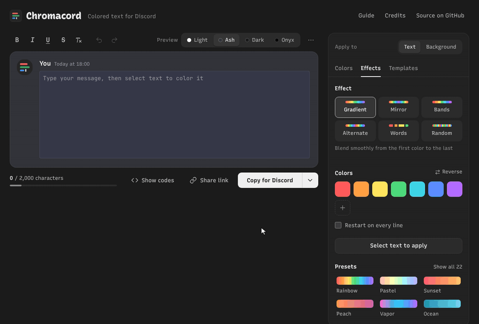
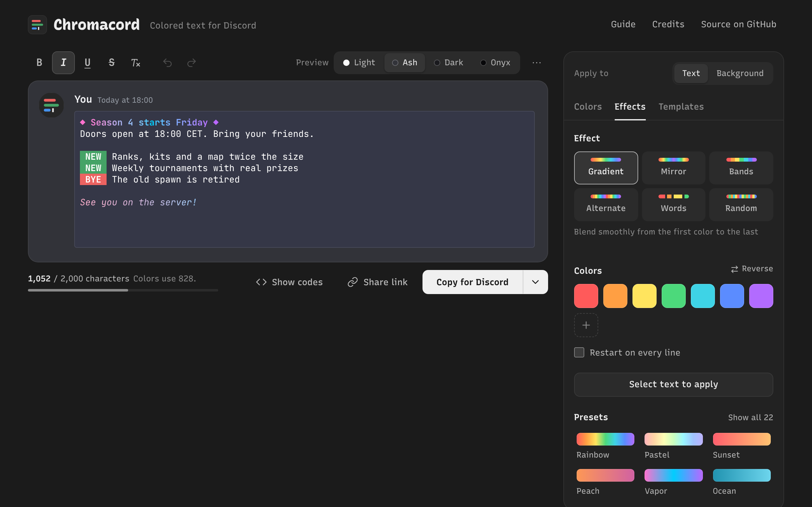
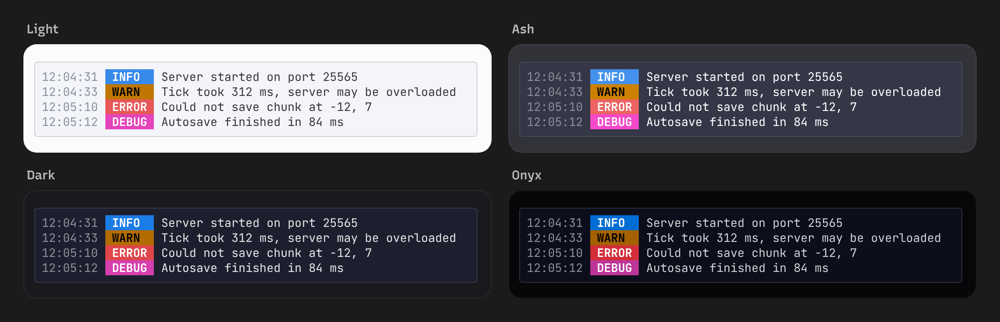
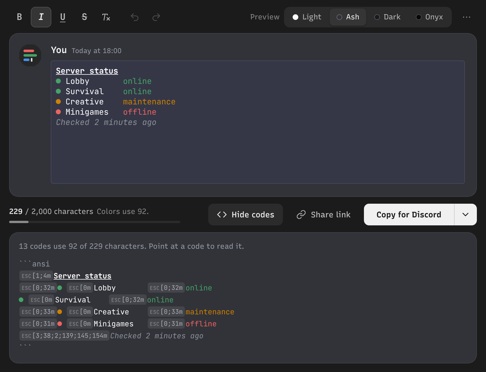
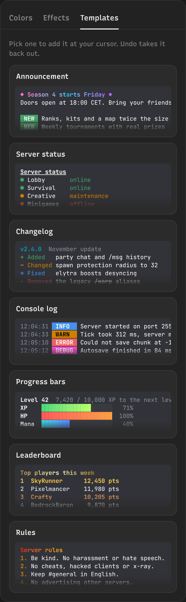
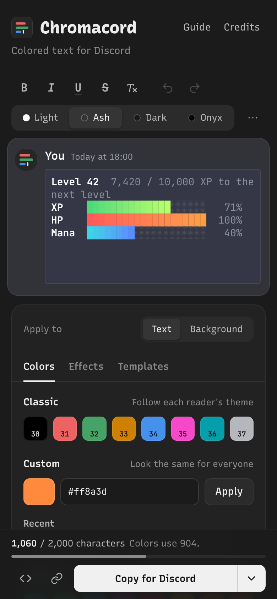
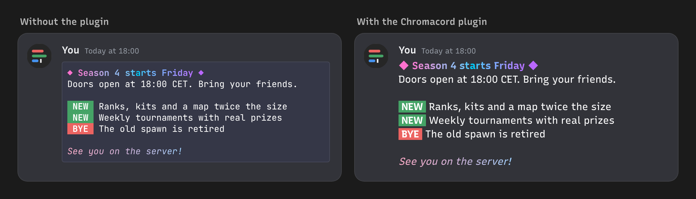

<div align="center">


# Chromacord

**Colored text for Discord.** Gradients, effects, templates and a live preview for Discord's ANSI code blocks.

[**Open Chromacord**](https://reimaginedpixel.github.io/chromacord/) &nbsp;|&nbsp; [Vencord plugin](#vencord-plugin) &nbsp;|&nbsp; [How it works](#how-discord-colors-text) &nbsp;|&nbsp; [Credits](#credits) &nbsp;|&nbsp; [Report a problem](https://github.com/ReimaginedPixel/chromacord/issues)

[](https://github.com/ReimaginedPixel/chromacord/actions/workflows/pages.yml)
[](LICENSE)




</div>

## What it is

Discord can color text inside code blocks marked `ansi`, but writing the escape codes by hand is painful. Chromacord is an editor for those messages: type your text, select a piece of it, pick a color or an effect, and copy the finished message into any channel.

It grew out of [Rebane's Discord Colored Text Generator](https://rebane2001.com/discord-colored-text-generator/), rebuilt from scratch with a proper editor, effects and a preview of every Discord theme. Everything runs in your browser.

## Features

- **Edit like a normal text editor.** Select text and press <kbd>Ctrl</kbd>+<kbd>B</kbd>, <kbd>I</kbd>, <kbd>U</kbd>, or pick a color. Full undo and redo, and your draft survives a reload.
- **Every color Discord supports.** The 8 classic ANSI colors plus any 24-bit color, for text and for backgrounds. Bold, italic, underline and strikethrough.
- **Effects.** Gradient, mirror, bands, alternate, per word and random, with 22 presets including pride flags. Gradients blend in OKLab, so the middle stays bright instead of turning muddy.
- **Templates.** Announcement, server status, changelog, console log, progress bars, leaderboard and rules, ready to edit.
- **Preview in every theme.** Light, Ash, Dark and Onyx use the palettes Discord draws, because the classic colors change with the reader's theme.
- **Codes view.** Shows every escape code in your message, how many characters it costs and what it does.
- **Short output.** Only the styles that change get written, spaces skip codes they can't show, and a counter tracks the 2,000 and 4,000 (Nitro) character limits.
- **Copy for bots.** Get the message as a discord.js, discord.py or JDA line, a webhook body, or an escaped string for any language.
- **Paste or import colored text.** Discord messages, bot strings with `\u001b` escapes and terminal output (bright and 256 colors are mapped to what Discord can show).
- **Share links.** The whole message lives in the link, nothing gets uploaded.
- **Vencord plugin.** Shows colored code blocks as plain colored text right in Discord, and adds a chat bar button to color your own messages.
- **No tracking, no external requests, no build step, no dependencies.** Fonts are self-hosted.

## Screenshots



**Every Discord theme.** Classic colors follow the reader's theme, custom colors look the same everywhere.



**See the codes.** Every escape code in the message, inline, with a plain-language explanation on hover.



<table>
<tr>
<td width="55%" valign="top"><b>Templates</b><br><br></td>
<td width="45%" valign="top"><b>On your phone</b><br><br></td>
</tr>
</table>

## Vencord plugin

If you use [Vencord](https://vencord.dev), the plugin in [`vencord/`](vencord) brings Chromacord into Discord itself.

- Messages with an `ansi` code block show as normal chat text in their colors, without the code block box. People without the plugin still see the regular colored code block.
- A chat bar button colors the selected text, or the whole draft: classic colors, any custom color, gradient presets, bold, italic, underline and strikethrough. The result is a normal `ansi` block, so everyone sees the colors.



To install it:

1. Build Vencord from source: clone [Vencord](https://github.com/Vendicated/Vencord) and run `pnpm install --frozen-lockfile` in it.
2. Copy the `vencord/chromacord` folder of this repository to `Vencord/src/userplugins/chromacord`.
3. Run `pnpm build` and `pnpm inject` in the Vencord folder, restart Discord and turn on **Chromacord** in **Settings > Vencord > Plugins**.

Client mods are against Discord's Terms of Service, so install it only if you accept that risk. The [plugin README](vencord/README.md) has the details, the settings and the browser and Vesktop steps.

## How Discord colors text

A colored message is a code block with the language set to `ansi`. Inside it, the escape character (ESC, `U+001B`, written `\u001b` in code) followed by `[`, some numbers and `m` changes the style of everything after it.

````text
```ansi
\u001b[1;31mBold red\u001b[0m, then \u001b[38;2;124;134;255mindigo\u001b[0m
```
````

| Code | Does |
| --- | --- |
| `ESC[0m` | Reset everything |
| `ESC[1m`, `ESC[3m`, `ESC[4m`, `ESC[9m` | Bold, italic, underline, strikethrough |
| `ESC[30m` to `ESC[37m` | Classic text colors: black, red, green, yellow, blue, magenta, cyan, white |
| `ESC[40m` to `ESC[47m` | Classic backgrounds, same order |
| `ESC[38;2;R;G;Bm` | Any text color |
| `ESC[48;2;R;G;Bm` | Any background color |

Codes combine with semicolons, so `ESC[1;4;38;2;124;134;255m` is bold, underlined indigo. Discord ignores codes it doesn't know, like dim (2) or reverse (7).

Chromacord writes the shortest sequence it can: it only adds what changed between two pieces of text, resets only when a style has to be switched off, and doesn't spend codes on spaces that can't show them. When a change would be a single parameter such as `ESC[31m`, it writes `ESC[0;31m` instead, the `{format};{color}` shape every Discord ANSI guide uses.

A few things worth knowing:

- Colors show on Discord desktop and in the browser. Mobile support has historically lagged behind, and 24-bit colors only rolled out widely in October 2026, so older apps may show plain text or only the classic eight.
- Color codes count toward the message limit. An effect that colors every letter adds about 19 characters per letter.
- Three backticks inside your text would close the code block early, so Chromacord breaks them up with a zero width space.

### Sending it from a bot

Pick a format from the arrow next to **Copy for Discord**, or build the string yourself:

```js
// discord.js
await channel.send("```ansi\n\u001b[1;32mServer online\u001b[0m\n```");
```

```python
# discord.py
await channel.send("```ansi\n\u001b[1;32mServer online\u001b[0m\n```")
```

```java
// JDA
channel.sendMessage("```ansi\n\u001b[1;32mServer online\u001b[0m\n```").queue();
```

## Run it locally

Download or clone the repository and open `index.html`. That's it, no server and no install needed.

```bash
git clone https://github.com/ReimaginedPixel/chromacord.git
```

Opened from disk, some browsers block the web fonts and use system fonts instead. To see it exactly as hosted, serve the folder with `npm start` (or `python -m http.server 8080`) and open http://localhost:8080.

## Host your own copy

1. Fork the repository, or push this folder to a new GitHub repository.
2. Open **Settings > Pages** and set **Source** to **GitHub Actions**.
3. Push to `main`. The workflow runs the tests, then publishes the site.
4. If your URL differs from `reimaginedpixel.github.io/chromacord`, update the `canonical` and `og:` links in `index.html` and refresh the Discord link preview:

   ```bash
   node scripts/embed.mjs https://your-name.github.io/your-repo/
   ```

## Development

| Command | What it does |
| --- | --- |
| `npm install` | Installs esbuild, the only dev dependency |
| `npm run build` | Bundles `assets/js/` into `assets/js/chromacord.js`, the script the page loads, and copies the shared modules into the Vencord plugin. Run it after editing any module |
| `npm test` | Checks the bundle and the plugin copies are up to date, then runs the unit tests for the encoder, parser, colors, effects and the Vencord plugin |
| `python3 tests/e2e.py` | Browser tests for the editor. Needs Playwright and Chrome, and a server on port 8765 |
| `python3 scripts/screenshots.py` | Regenerates the screenshots, the demo GIF, the social card and the favicons |
| `node scripts/embed.mjs` | Rewrites the Discord link preview in `index.html` |

```text
index.html               the page
assets/css/app.css       styles, including the four Discord theme palettes
assets/js/core/          pure logic, no DOM: styles, ANSI encoder and parser, colors, effects, share links
assets/js/data/          classic colors, palettes, effect presets, templates
assets/js/ui/            the editor (contenteditable driven by a document model) and small UI helpers
assets/js/main.js        wires the editor, the panel and the output together
assets/js/chromacord.js  the bundle the page loads, built from the modules above (don't edit by hand)
vencord/chromacord/      the Vencord plugin, with its own copy of the shared modules in lib/
tests/                   node:test unit tests and the Playwright browser tests
scripts/                 the bundler, image generators and the embed writer
```

The editor keeps the text and one style per character in a small immutable model. Typing, deleting, pasting and undo go through that model and the DOM is re-rendered from it, while phone keyboards and input methods that can't be intercepted are read back from the DOM when they finish.

Pull requests are welcome. Please run `npm run build` and `npm test` (and the browser tests if you touched the editor) before opening one.

## Credits

Chromacord stands on the work of the people who figured this out first.

- **[Rebane](https://rebane2001.com/discord-colored-text-generator/)** (rebane2001) made the original Discord Colored Text Generator in 2022 and released it into the public domain ([source](https://gist.github.com/rebane2001/07f2d8e80df053c70a1576d27eabe97c)). Chromacord started as a rebuild of that tool, and its theme preview uses the palettes Rebane collected from Discord's client.
- **[kkrypt0nn](https://gist.github.com/kkrypt0nn/a02506f3712ff2d1c8ca7c9e0aed7c06)** wrote "A guide to ANSI on Discord", the reference most tools and bots learned from.
- **[TinyVirtual](https://gist.github.com/kkrypt0nn/a02506f3712ff2d1c8ca7c9e0aed7c06?permalink_comment_id=6224323#gistcomment-6224323)** spotted Discord's 24-bit color support while it was still an experiment and shared the first working example.
- Set in [Recursive](https://www.recursive.design/) by Arrow Type and [JetBrains Mono](https://www.jetbrains.com/lp/mono/) by JetBrains, both under the SIL Open Font License.

## License

[MIT](LICENSE). The fonts in `assets/fonts` keep their own SIL Open Font License.

Chromacord is an unofficial tool and is not affiliated with or endorsed by Discord.
