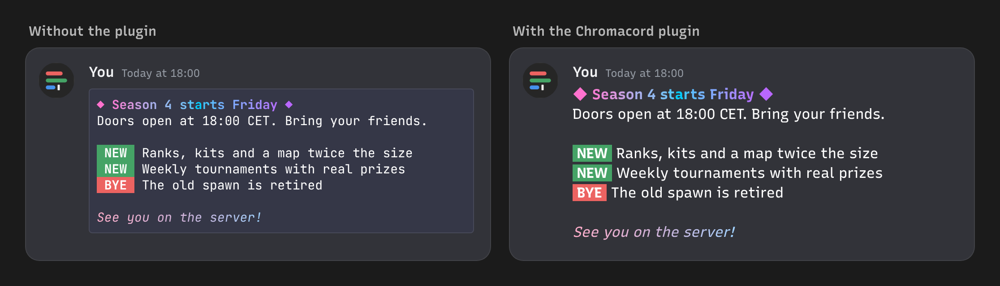

# Chromacord for Vencord

A [Vencord](https://vencord.dev) plugin that brings Chromacord into the Discord client.

- **Colored code blocks become colored text.** A message with an `ansi` code block shows as normal chat text in its colors, with no code block box around it. Everyone without the plugin still sees the usual colored code block, so nothing breaks for them.
- **Color your own messages.** A button in the chat bar colors the selected text, or the whole draft when nothing is selected: the 8 classic colors, any custom color, or one of the 22 gradient presets, with bold, italic, underline and strikethrough. It writes a normal ```` ```ansi ```` block, so the colors show for everyone.



> [!WARNING]
> Client mods like Vencord are against Discord's Terms of Service. Vencord knows of no one banned just for using a client mod, but there is no guarantee. Install it only if you accept that risk.

## Install

Vencord only loads plugins that are not part of it when you build Vencord yourself. You need [Git](https://git-scm.com), [Node.js](https://nodejs.org) 20 or newer and [pnpm](https://pnpm.io).

1. Get the Vencord source and its dependencies:

   ```bash
   git clone https://github.com/Vendicated/Vencord.git
   ```

   ```bash
   cd Vencord && pnpm install --frozen-lockfile
   ```

2. Copy the `vencord/chromacord` folder from this repository to `Vencord/src/userplugins/chromacord`. Create `userplugins` if it doesn't exist.
3. Build Vencord and add it to Discord:

   ```bash
   pnpm build
   ```

   ```bash
   pnpm inject
   ```

   For the browser extension run `pnpm buildWeb` instead and load `dist/chromium-unpacked`. For Vesktop, point its Vencord location setting to the `dist` folder.
4. Restart Discord, open **Settings > Vencord > Plugins** and turn on **Chromacord**.

To update, copy the folder again and rerun `pnpm build`. The full guide is in Vencord's docs under [Installing custom plugins](https://docs.vencord.dev/installing/custom-plugins/).

## Use it

Select some text in the chat box and press the button with the colored bar, or press it with nothing selected to color the whole draft. Pick a color, a gradient or a style, check the preview, then press **Insert** to put the colored message in the chat box, or **Copy** to copy it.

## Settings

| Setting | Default | |
| --- | --- | --- |
| Show ansi code blocks as colored text | On | Turn off to see the normal code block again |
| Keep the monospace font | Off | Keeps the colors but uses the code font, so text drawn with spaces (tables, ASCII art) stays lined up |

To hide the chat bar button, use **Manage plugin UI elements** on Vencord's Plugins page, or right-click the chat bar and open **Vencord Buttons**.

## How it works

- The plugin replaces what Discord draws for code blocks marked `ansi` (any case, like Discord). Every other code block is untouched.
- It reads the codes exactly like Discord's own renderer, including its quirks: bright colors (90 to 97) keep their own shade, `ESC[m` with no number changes nothing, and 21 turns bold off. Classic colors use Discord's `--ansi-*` theme variables, so they follow your theme, high contrast mode and client theme the same way Discord's code blocks do.
- The chat bar tool uses Chromacord's encoder, so it writes the same short codes as the website.

## For developers

The folder is self-contained so it can be copied into Vencord as is.

| File | What it does |
| --- | --- |
| `index.tsx` | The plugin: the code block patch and the chat bar button |
| `tokenize.js` | Reads an ansi block the way Discord does. Pure, unit tested in `tests/vencord.test.js` |
| `colorize.js` | Builds the message the chat bar tool writes. Pure, unit tested |
| `AnsiText.tsx` | Draws an ansi block as text |
| `ColorModal.tsx`, `chatBox.ts` | The chat bar tool and how it reads the chat box |
| `lib/` | Copies of Chromacord's encoder, colors, effects and palettes. Written by `npm run build` in this repository, don't edit them here |

Upstream Vencord only takes plugins written for it under its GPL license header and [contribution rules](https://github.com/Vendicated/Vencord/blob/main/CONTRIBUTING.md), so submitting this one would need those changes first.
